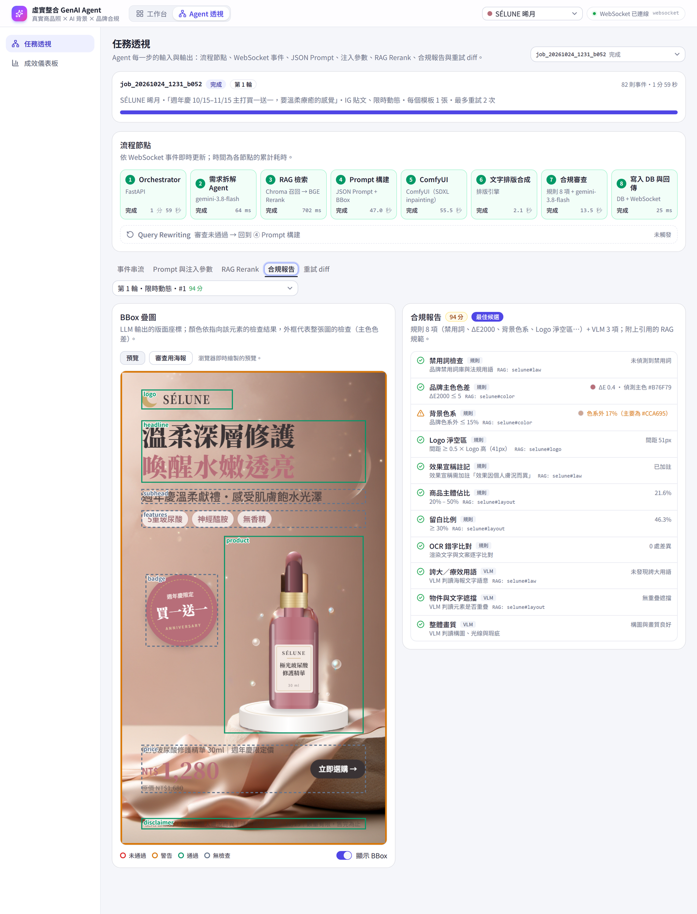
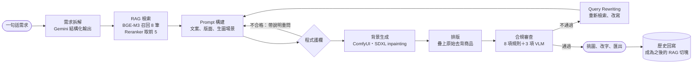
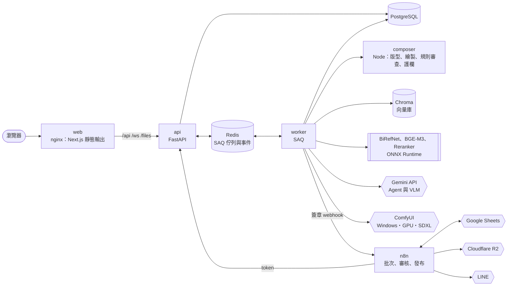
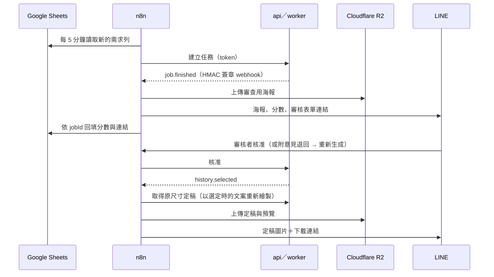

# 虛實整合 GenAI Agent

**一句話需求 → 符合品牌規範的電商海報。以 LLM Agent、RAG 與擴散模型生成，再以規則與 VLM 自動審查，最後經 LINE 審核發布。**

🔗 **線上 Demo**：https://genai-agent-studio.kayla-swag-19.workers.dev/
（在瀏覽器內模擬整條流程，不需要登入，也不呼叫付費 API。完整系統用 Docker 在本機執行，見[快速開始](#快速開始)。）

> *A multimodal agent system that turns a one-line brief into brand-compliant e-commerce posters: Gemini for planning and VLM review, RAG over brand guidelines (BGE-M3 + reranker on ONNX), SDXL inpainting on a local GPU, an event-sourced FastAPI/PostgreSQL backend, and an n8n pipeline that runs batches from Google Sheets, reviews on LINE and publishes the final poster to Cloudflare R2.*

<table>
  <tr>
    <td width="33%" valign="top"></td>
    <td valign="top"></td>
  </tr>
  <tr>
    <td valign="top"><b>成品海報</b>：示範品牌 SÉLUNE（虛構）的限時動態。背景由 SDXL 在本機 GPU 生成，商品用原始示範圖，文字由程式排版。</td>
    <td valign="top"><b>Agent 透視</b>：同一個任務的 8 個流程節點和各自的耗時、Gemini 產生的版面方框（疊在海報上），以及 11 項合規檢查和引用的 RAG 規範。</td>
  </tr>
</table>

## 解決什麼問題

電商每檔活動都要在 IG 貼文、限時動態、橫幅等多種尺寸各做一批海報，每一張都要符合品牌規範：品牌色、字型、禁用詞、法規用語、Logo 淨空區。直接用生成式 AI 會遇到三個問題：

- **商品被改掉**：擴散模型會重畫商品，包裝上的字和形狀都會變。
- **品牌規範難以遵守**：色碼、禁用詞、誇大療效的用語，模型不一定照做，人工逐張檢查很花時間。
- **無法放進團隊流程**：產圖、審核、改稿、發布分散在不同工具，來回溝通。

這個系統把整條流程自動化。

1. **規劃**：Gemini 拆解需求，從品牌知識庫檢索規範（RAG）。
2. **構建**：產生文案、版面和生圖提示詞，並經過程式護欄檢查。
3. **生成**：在本機 GPU 用 SDXL 只重繪背景，疊上原始商品圖，排出 5 種通路尺寸。
4. **審查**：11 項檢查（8 項規則＋3 項 VLM）審核品牌合規。不通過時自動改寫、重新生成。
5. **審核與發布**：可以從 Google 試算表批次下單。結果推播到 LINE，審核者在表單上核准或附意見退回。核准後，原尺寸定稿上傳到 Cloudflare R2，下載連結再推播到 LINE。

## 展示影片

https://github.com/user-attachments/assets/51fe7d6e-edaf-4d47-9fde-d8366d132252

約 60 秒，以本機的完整系統跑一個真實任務（加速播放，生圖等待的部分為 12 倍速）：

1. 在 Studio 輸入一句話需求，Gemini 拆解需求。
2. Agent 透視即時顯示各節點的進度：RAG 檢索、Prompt 構建、SDXL 生圖、合規審查。
3. 通過審查的候選海報與合規報告（8 項規則＋3 項 VLM）。
4. 在 n8n 審核表單按下核准，原尺寸定稿上傳到 Cloudflare R2。
5. 手機 LINE 收到審核通知，以及定稿圖片與下載連結。
6. 定稿寫入歷史紀錄並回寫 RAG。

## 用了哪些技術？以及為什麼？

| 領域 | 技術 | 為什麼選它 |
|---|---|---|
| LLM Agent | **Gemini**（`google-genai`，JSON Schema 結構化輸出） | 一次呼叫就能產生文案、8 個元素的版面方框和生圖場景，格式由 Schema 保證，程式可以直接驗證。同一個模型也能當 VLM 評審，看圖判斷遮擋與誇大用語。 |
| RAG | **BGE-M3**＋**bge-reranker-v2-m3**（ONNX Runtime int8）、**Chroma** | 中文表現好，在 CPU 上就跑得動，不需要額外付費的 embedding API。先召回、再重排，可以提高放進 Prompt 的規範的精準度。Chroma 輕量，只當索引用，資料以 PostgreSQL 為準。 |
| 圖像生成 | **SDXL**＋**SDXL-Lightning** LoRA（ComfyUI） | 授權允許商用，8 步就能出圖。6 GB 筆電 GPU 每張 14–17 秒。用 inpainting 只重繪背景，商品不會被改動。 |
| 商品去背 | **BiRefNet**（ONNX） | 邊緣細節好，在本機執行。去背後疊回原始商品像素，與原圖平均只差 0.67／255。 |
| 後端 | **FastAPI**、**SQLAlchemy async**＋**Alembic**、**PostgreSQL** | 原生非同步，適合 WebSocket 串流和大量外部呼叫。PostgreSQL 是唯一的資料來源：事件溯源、webhook outbox 和業務資料都在同一個交易中寫入。 |
| 佇列與即時事件 | **Redis**＋**SAQ** | 輕量的 asyncio 工作佇列，可以中斷進行中的任務。Redis Pub/Sub 把事件推送到 WebSocket。 |
| 前端與排版 | **Next.js 16**（靜態輸出）、**TypeScript**、Tailwind CSS v4、shadcn/ui、Zustand、`@napi-rs/canvas` | 版型、繪製、規則審查與護欄只用 TypeScript 寫一次：瀏覽器直接執行，伺服器端透過 Node 服務（composer）畫出完全相同的海報。 |
| 自動化 | **n8n** | 用視覺化工作流串接試算表、LINE、表單與 R2，不寫程式也能調整審核流程。工作流以 JSON 版本控管、有測試。 |
| 通知與發布 | **LINE Messaging API**、**Cloudflare R2** | LINE 是台灣團隊最常用的通訊工具，在手機上就能審核。R2 相容 S3、流量免費，提供 LINE 圖片訊息需要的公開 HTTPS 網址。 |
| 部署與 CI | **Docker Compose**、nginx、**GitHub Actions**、Cloudflare Workers | 一個指令就能啟動 7 個服務，n8n 用 profile 另外加上。每個 PR 都會跑後端與前端的完整測試。作品集 Demo 以靜態網站部署。 |

## 架構

### Agent 流程



### 系統元件



### 審核與發布



## 工程亮點

- **可控的 LLM 輸出**：結構化輸出、程式護欄，加上「帶中文說明重問」。護欄檢查禁用詞、字型缺字、需求沒提到的價格、版面重疊、商品佔比、Logo 淨空區和字級。30 次 Prompt 構建全部第一次就通過格式與護欄。
- **可量測的評估**：VLM 評審抓到刻意植入的錯字與缺字 30/30。轉錄時不提供預期文案，避免模型照抄。背景色系、品牌主色等指標從像素計算，門檻用實際生成的圖片校準。
- **不漏送的 webhook（transactional outbox）**：通知和業務事件在同一個 PostgreSQL 交易內寫入。worker 以 `FOR UPDATE SKIP LOCKED` 發送，HMAC-SHA256 簽章，依退避表最多重送 8 次，接收端依 id 去重。核准與退回支援 Idempotency-Key。
- **事件溯源與即時串流**：任務事件在交易中取得序號，再經 Redis 推送到 WebSocket。斷線後依序號補送；Redis 停止時改從資料庫讀取，連線不中斷。
- **資料來源與衍生索引分離**：RAG 切塊以 PostgreSQL 為準，Chroma 只是索引。向量庫遺失後約 6.5 秒自動重建，分數與重建前完全相同。換了 embedding 模型時，會依模型指紋自動重建。
- **人在迴圈中的回饋學習**：選定的海報回寫成 RAG 切塊，下一個任務的召回與 Rerank 都把它排第一（Rerank 0.97）。退回意見會進入 RAG 查詢、Prompt 構建和價格護欄。
- **資源受限下的穩定性**：在 16 GB 筆電上，生圖與去背用 Redis 鎖互斥。推論中斷 2 次就判定失敗並說明原因，避免 worker 無限重啟。容器不以 root 執行，nginx 和 API 都檢查 Host，防止 DNS rebinding。
- **成本治理**：每次呼叫都記錄 tokens（含思考）與費用，單價依生效日期計算。單一任務和每月各有費用上限，儀表板依實際用量算出每張海報的成本。
- **測試與流程**：後端 520+ 個、前端 610+ 個測試。Gemini 與 ComfyUI 的回應錄下來重播，測試不依賴外部服務。前後端用同一組 golden fixtures 比對。每個階段都先寫設計規格與實作計畫：11 份規格、290+ 個 commit、37 個 PR，每個 PR 都由 GitHub Actions 檢查。

### 問題與解法

| 問題 | 怎麼發現 | 解法 | 結果 |
|---|---|---|---|
| **背景多畫出帶假標籤的瓶子**，擋到標題 | VLM 判定遮擋；追查 Gemini 產生的場景描述 | 提示詞範例寫了 "serum bottle on …"，模型照抄。改寫說明，並在護欄攔下提到容器的場景描述、帶說明重問 | 同一個任務第 1 輪就 100 分 |
| **SDXL 看不懂色碼**，玫瑰色系的品牌生成綠色背景 | 背景色系指標：一般背景只有 7/15 通過 | 色票改用色名、cfg 1→2 讓負面提示詞生效、用場景描述取代「商品攝影」，共做了 4 輪實驗 | 一般背景 15/15 通過，每張 14 秒 |
| **品牌主色的量法不可靠** | 原本的量法（背景面積最大的顏色）：30 張配色正確的海報 0 張通過 | 改量一定以主色繪製的元素（標題、售價、徽章），扣掉商品區塊，取最接近主色的色塊 | 正確配色 180/180 通過、錯誤配色 180/180 不通過 |
| **int8 向量化結果不穩定** | 同一段文字單獨算和批次算，餘弦相似度最低只有 0.971 | 追到動態量化以整個批次計算縮放值，改成逐筆計算 | 結果固定，速度還快 10–14% |
| **試算表回填依賴列號** | 檢視流程時發現：任務建立時記下列號，之後有人插入或排序，回填就會寫到別的列 | 回填前依 jobId（退回產生的任務用上一個任務的 jobId）找出那一列，再更新 | 實測在上方插入一列後，仍回填到正確的列 |

### 量測結果

| 項目 | 結果 |
|---|---|
| Gemini 結構化輸出（3 品牌 × 5 模板 × 2 次） | 格式第一次就通過 30/30；不必重問就通過全部護欄 30/30 |
| VLM 轉錄（15 張正確的海報） | 0 處差異 15/15；刻意換字或缺字的 30 張全部抓到 |
| VLM 判讀（正確、遮擋、誇大各 3 張） | 9/9 判斷正確；同一張審查 3 次，結果一致 |
| RAG int8 與 fp32 | 10 個查詢的第一名都相同；查詢向量化約 0.023 秒 |
| 背景生成（RTX 3060 Laptop 6 GB） | 每張 14–17 秒（目標 ≤ 60 秒） |
| 自動改寫 | 要求螢光色背景：第 1 輪色系外 38%，改寫後第 2 輪 2%，100 分通過 |
| 費用 | Prompt 構建每次約 US$0.021、VLM 審查約 US$0.003；3 個模板 × 2 張、重試一輪約 US$0.18 |

## 快速開始

**只看介面**：直接開[線上 Demo](https://genai-agent-studio.kayla-swag-19.workers.dev/)，或在本機執行。這種方式在瀏覽器內模擬整條流程，不需要後端、GPU 或 API key：

```bash
cd web
npm ci
npm run dev
```

**完整系統**：需要 Docker Desktop。Gemini API key 和 ComfyUI 都可以不設定，沒有時改用模擬模式。

```bash
cp .env.example .env
docker compose up -d --build
```

接著開啟 http://127.0.0.1:3000。

**自動化（試算表批次、LINE 審核、R2 發布）**：

```bash
docker compose --profile automation up -d --build
```

設定 LINE、R2 與 Google Sheets 的步驟見 [n8n/README.md](n8n/README.md)。

## 深入閱讀

| 文件 | 內容 |
|---|---|
| [操作手冊](docs/operations.md) | 安裝、設定、執行、測試與系統行為細節 |
| [n8n 自動化](n8n/README.md) | 工作流、LINE、R2、Google Sheets 的設定與測試 |
| [設計規格](docs/superpowers/specs/) | 每個階段的設計、實驗結果與決策（[後端總覽](docs/superpowers/specs/2026-10-07-phase2-backend-design.md)、[Gemini 與 VLM](docs/superpowers/specs/2026-10-23-plan6b-gemini-vlm-design.md)、[RAG](docs/superpowers/specs/2026-10-21-plan5-rag-design.md)、[ComfyUI](docs/superpowers/specs/2026-10-23-plan7-comfyui-design.md)、[選圖後發布](docs/superpowers/specs/2026-11-07-publish-on-select-design.md)） |
| [實作計畫](docs/superpowers/plans/) | 每個階段的實作步驟 |
| [backend/README.md](backend/README.md)、[web/README.md](web/README.md) | 後端與前端各自的說明 |
| [comfyui/README.md](comfyui/README.md) | ComfyUI 安裝、模型與授權 |

## 授權

本專案是個人作品集，程式碼著作權歸作者所有。

使用的第三方模型與字型都允許商用：

- **SDXL base 1.0、SDXL-Lightning**：CreativeML Open RAIL++-M（[comfyui/README.md](comfyui/README.md)）
- **Noto Sans TC、Noto Serif TC**：SIL Open Font License 1.1
- **BGE-M3**：MIT；**bge-reranker-v2-m3**：Apache-2.0
- **BiRefNet**（rembg 發布的 ONNX）：MIT

示範品牌（SÉLUNE 等）與商品圖都是虛構的。
