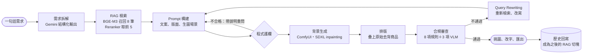
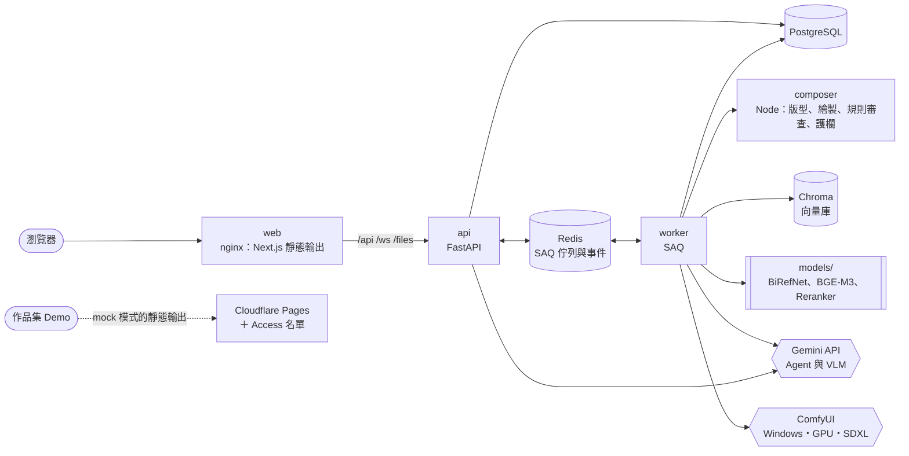

# 虛實整合 GenAI Agent

**以 LLM Agent、RAG 與擴散模型產生電商海報，並以規則與 VLM 自動審查品牌合規的多模態系統。**

輸入一句話需求，例如「週年慶主打買一送一，要溫柔療癒的感覺」，系統依序：
1. 以 Gemini 拆解需求。
2. 從品牌知識庫檢索規範。
3. 產生文案、版面與生圖提示詞。
4. 在本機 GPU 以 SDXL 生成背景。
5. 疊上原始商品圖，排出 5 種通路尺寸的海報。
6. 以 11 項檢查審查品牌合規。
7. 不通過時自動改寫、重新生成。

> *A multimodal agent system that turns a one-line brief into brand-compliant e-commerce posters: Gemini for planning and VLM review, RAG over brand guidelines (BGE-M3 + reranker on ONNX), SDXL inpainting on a local GPU, and an event-sourced FastAPI/PostgreSQL backend with measured, test-covered behaviour.*

## 重點

| 面向 | 做了什麼 |
|---|---|
| **LLM Agent** | 結構化輸出（JSON Schema）＋程式護欄＋帶說明重問；不通過審查時以 Query Rewriting 重新檢索、改寫後再生成一輪 |
| **RAG** | BGE-M3 向量化、bge-reranker-v2-m3 重新排序（int8 ONNX，CPU）；PostgreSQL 為資料來源、Chroma 為可重建的索引；PDF／Markdown 手冊上傳與歷史回寫 |
| **電腦視覺** | BiRefNet 商品去背；SDXL＋Lightning LoRA 只重繪商品以外的背景，商品像素一律用原圖；從像素量測品牌色差（ΔE2000）與背景色系（LCh） |
| **評估** | Gemini 作為 VLM 評審（誇大、遮擋、畫質）＋轉錄文字與實際文案比對錯字；每個門檻都以實驗校準並記錄在設計規格 |
| **資料工程** | 事件溯源：每個任務事件依序號寫入 PostgreSQL，經 Redis 推送到 WebSocket，斷線以序號補送；用量帳本與費用上限；佇列、取消與資源鎖 |
| **工程品質** | 後端 400+、前端 600+ 個測試；Python 與 TypeScript 共用的契約測資；GitHub Actions 以服務容器跑 PostgreSQL、Redis、Chroma |

## 系統流程



## 技術重點

### AI 與 LLM 應用

- **可控的 LLM 輸出**：
  - Gemini 以 JSON Schema 產生每個模板的文案、8 個元素的版面方框與生圖場景。
  - 程式護欄檢查：禁用詞、字型缺字、需求沒提到的價格、版面重疊、商品佔比、留白、Logo 淨空區與字級。
  - 不合格時帶著中文說明重問一次，仍不合格就退回預設值。
  - 背景曾多畫出帶假標籤的瓶子：追到提示詞的範例，改說明並在護欄攔下提到容器的場景描述。
- **RAG**：
  - 品牌設定檔、上傳的手冊與選定的海報都切成切塊。
  - 先向量召回 8 筆，Reranker 重新排序後前 5 筆放進 Prompt。
  - 改寫時另外檢索合規替代用語與法規切塊。
  - 實測發現 int8 動態量化會因批次改變結果，改為逐筆計算：結果固定，速度也快 10–14%。
  - 兩個模型共用一個 tokenizer，省下約 285 MB。
- **VLM 評審與 OCR 比對**：
  - Gemini 讀伺服器端畫出的審查用海報，判斷誇大、遮擋與畫質。
  - 轉錄時不提供預期文案，避免模型照抄；轉錄結果再與實際畫出的文字比對錯字。
- **擴散模型**：
  - 商品放在版面方框，生成遮罩；SDXL 只重繪背景，最後疊回原始去背圖。
  - 標籤文字與外形不會被模型改動，實測商品區域與原圖平均差 0.67／255。
- **背景色系指標**：
  - 每個像素轉成 LCh，依品牌色的色相與彩度判斷是否在色系內。
  - 門檻以 24 張實際生成的背景離線校準。
- **成本治理**：
  - 每次呼叫記錄 tokens（含思考）與費用，單價依生效日期計算。
  - 單一任務與每月各有費用上限，儀表板以實際用量算每張成本。

### 資料工程與後端

- **事件溯源與即時串流**：
  - 任務事件在同一個交易中取得序號並寫入 PostgreSQL，再經 Redis 推送到 WebSocket。
  - 斷線或重新整理後以最後的序號補送。
  - Redis 停止時改為每秒從資料庫讀取，連線不中斷。
- **資料來源與衍生索引分離**：
  - 切塊以 PostgreSQL 為準，Chroma 只是索引。
  - worker 啟動與每次檢索前比對並補齊；刪掉向量庫後約 6.5 秒自動重建，分數與重建前完全相同。
- **文件攝取管線**：
  - 支援 Markdown、文字檔與 PDF（文字層）：檢查大小與字數、切塊、向量化、以 id upsert。
  - 進度以串流回報；120 秒沒有進度才逾時，大檔案不會被固定時限誤殺。
- **工作佇列與資源管理**：
  - SAQ worker 處理任務、去背與文件攝取。
  - 取消會中斷進行中的 Gemini 呼叫與 ComfyUI prompt。
  - 16 GB 筆電上，生圖與去背以 Redis 鎖互斥，避免記憶體不足。
- **用量帳本**：`job_usage` 依台北時間的月份彙總，單價表有生效日期。

### 工程方法

- **一份實作、兩個執行環境**：版型、繪製、規則審查與護欄只用 TypeScript 寫一次，瀏覽器直接執行；後端透過 Node 服務（composer）呼叫同一份程式，在伺服器端畫出相同的海報。
- **契約測資**：前後端以同一組 golden fixtures 比對事件與審查結果。
- **測試不依賴外部服務**：Gemini 與 ComfyUI 的回應錄下來重播；真實呼叫另外標記為 `live`，手動執行。
- **先規格、再實作**：每個階段先寫設計規格與實作計畫，實驗結果、決策與已知限制都記錄在 [docs/superpowers/](docs/superpowers/)。

## 量測結果

| 項目 | 結果 | 來源 |
|---|---|---|
| Gemini 結構化輸出（3 品牌 × 5 模板 × 2 次） | 格式第一次就通過 30/30；不必重問就通過全部護欄 30/30 | [Gemini 規格 §12](docs/superpowers/specs/2026-10-23-plan6b-gemini-vlm-design.md) |
| VLM 轉錄（15 張正確的海報） | 0 處差異 15/15；刻意換字或缺字的 30 張全部抓到 | 同上 |
| VLM 判讀（正確、遮擋、誇大各 3 張） | 9/9 判斷正確；同一張審查 3 次，結果一致 9/9 | 同上 |
| RAG int8 與 fp32 | 向量餘弦相似度平均 0.98；10 個查詢的第一名都相同 | [RAG 規格 §2](docs/superpowers/specs/2026-10-21-plan5-rag-design.md) |
| RAG 延遲（CPU） | 查詢向量化約 0.023 秒；Rerank 8 筆約 1.4 秒 | 同上 |
| 歷史回寫 | 下一個任務的召回與 Rerank 都把它排第一（Rerank 0.97） | 同上 |
| 背景生成（RTX 3060 Laptop 6 GB） | 每張 14–17 秒（目標 ≤ 60 秒） | [ComfyUI 規格 §12](docs/superpowers/specs/2026-10-23-plan7-comfyui-design.md) |
| 背景色系檢查 | 一般背景 15/15 通過；刻意偏離色系的 9 張有 7 張不通過、1 張警告 | 同上 |
| 自動改寫 | 要求螢光色背景：第 1 輪色系外 38% 不通過，改寫後第 2 輪 2%、100 分通過 | 同上 |
| 費用 | Prompt 構建每次約 US$0.021、VLM 審查約 US$0.003；3 個模板 × 2 張、重試一輪約 US$0.18 | Gemini 規格 §12 |

已知限制與取捨（例如提示詞刻意要求的偏色，模型不一定照做；16 GB 筆電的記憶體很緊）都寫在各份規格的實驗結果。

## 架構



| 層 | 技術 |
|---|---|
| AI／模型 | Gemini（`google-genai`，結構化輸出、VLM）、BGE-M3、bge-reranker-v2-m3、BiRefNet（ONNX Runtime）、SDXL＋SDXL-Lightning（ComfyUI） |
| 後端 | Python 3.13、FastAPI、SAQ、SQLAlchemy＋Alembic、PostgreSQL、Redis、Chroma、httpx、pytest、mypy、ruff |
| 前端與排版 | Next.js 16（靜態輸出）、TypeScript、Tailwind CSS v4、shadcn/ui、Zustand、`@napi-rs/canvas`、Vitest、Playwright |
| 部署與 CI | Docker Compose、nginx、GitHub Actions、Cloudflare Pages＋Zero Trust Access |

## 快速開始

**只看介面**（瀏覽器內模擬整條流程，不需要後端、GPU 或 API key）：

```bash
cd web
npm ci
npm run dev
```

**完整系統**（需要 Docker Desktop；Gemini key 與 ComfyUI 可選，沒有時改用模擬模式）：

```bash
docker compose up -d --build
```

開啟 http://127.0.0.1:3000。設定、ComfyUI 安裝、記憶體建議、本機開發與測試見 [操作手冊](docs/operations.md)。

## 作品集 Demo

前端的 mock 模式以靜態網站部署在 Cloudflare Pages，以 Zero Trust Access 限制只有名單內的 email 可以觀看。部署方式見 [docs/demo/cloudflare.md](docs/demo/cloudflare.md)。

## 文件

| 文件 | 內容 |
|---|---|
| [操作手冊](docs/operations.md) | 安裝、設定、執行、測試與系統行為細節 |
| [設計規格](docs/superpowers/specs/) | 每個階段的設計、實驗結果與決策（[第二階段總覽](docs/superpowers/specs/2026-10-07-phase2-backend-design.md)） |
| [實作計畫](docs/superpowers/plans/) | 每個階段的實作步驟 |
| [backend/README.md](backend/README.md)、[web/README.md](web/README.md) | 後端與前端各自的說明 |
| [comfyui/README.md](comfyui/README.md) | ComfyUI 安裝、模型與授權（只使用允許商用的模型） |
