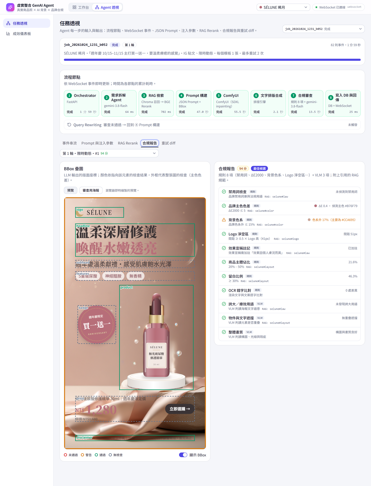
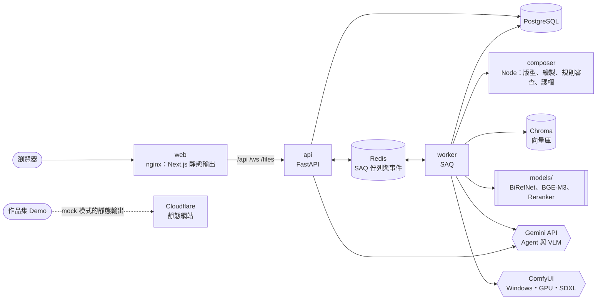

# 虛實整合 GenAI Agent

**以 LLM Agent、RAG 與擴散模型產生電商海報，並以規則與 VLM 自動審查品牌合規的多模態系統。**

🔗 **線上 Demo**：https://genai-agent-studio.kayla-swag-19.workers.dev/
（瀏覽器內模擬整條流程，不需登入、不呼叫任何付費 API；完整系統以 Docker 在本機執行，見[快速開始](#快速開始)）

輸入一句話需求，例如「週年慶主打買一送一，要溫柔療癒的感覺」，系統依序：
1. 以 Gemini 拆解需求，從品牌知識庫檢索規範（RAG）。
2. 產生文案、版面與生圖提示詞，經程式護欄檢查。
3. 在本機 GPU 以 SDXL 生成背景，疊上原始商品圖，排出 5 種通路尺寸的海報。
4. 以 11 項檢查（8 項規則＋3 項 VLM）審查品牌合規，不通過時自動改寫、重新生成。

> *A multimodal agent system that turns a one-line brief into brand-compliant e-commerce posters: Gemini for planning and VLM review, RAG over brand guidelines (BGE-M3 + reranker on ONNX), SDXL inpainting on a local GPU, and an event-sourced FastAPI/PostgreSQL backend with measured, test-covered behaviour.*

<table>
  <tr>
    <td width="33%" valign="top"></td>
    <td valign="top"></td>
  </tr>
  <tr>
    <td valign="top"><b>成品海報</b>：示範品牌 SÉLUNE（虛構）的限時動態。背景由 SDXL 在本機 GPU 生成，商品為原始示範圖，文字由程式排版。</td>
    <td valign="top"><b>Agent 透視</b>：同一個任務的 8 個流程節點與耗時、Gemini 產生的版面方框疊在海報上，以及 11 項合規檢查與引用的 RAG 規範。</td>
  </tr>
</table>

## 亮點

- **可控的 LLM 輸出**：Gemini 結構化輸出＋程式護欄＋帶說明重問。30 次 Prompt 構建全部一次通過格式與護欄；不通過審查時以 Query Rewriting 重新檢索、改寫。
- **可量測的評估**：VLM 評審抓到刻意植入的錯字與缺字 30/30；背景色系、品牌主色等指標都從像素計算，門檻以實際生成的圖片校準。
- **商品不被模型改動**：SDXL 只重繪背景，商品一律用原始去背圖，商品區域與原圖平均只差 0.67／255。
- **可靠的後端**：事件溯源＋WebSocket 斷線補送、PostgreSQL 為準且可自動重建的向量索引、16 GB 筆電上的記憶體互斥與中斷防護；容器不以 root 執行。
- **工程規模**：2026-10-05 至 10-28，8 個階段、約 260 個 commit、30 個 PR；後端 430+、前端 610+ 個測試，GitHub Actions 每個 PR 執行。

## 挑戰與解法

| 問題 | 怎麼發現 | 解法 | 結果 |
|---|---|---|---|
| **背景多畫出帶假標籤的瓶子**，擋到標題 | VLM 判定遮擋、任務轉人工審核；追查 Gemini 產生的場景描述 | 提示詞範例寫了 "serum bottle on …"，Gemini 照抄、SDXL 照畫：改寫說明，並在護欄攔下提到容器的場景描述、帶說明重問 | 同一個任務第 1 輪就 100 分，背景沒有多餘的商品 |
| **SDXL 看不懂色碼**，玫瑰色系的品牌生成綠色背景 | 背景色系指標：一般背景只有 7/15 通過 | 色票改用色名、cfg 1→2 讓負面提示詞生效、場景描述取代「商品攝影」，共 4 輪實驗 | 一般背景 15/15 通過，刻意偏色的 9 張抓到 8 張；每張 14 秒 |
| **品牌主色的量法不可靠** | 規格原本的量法（背景面積最大的顏色）：30 張配色正確的海報 0 張通過 | 改量一定以主色繪製的元素（標題、售價、徽章），扣掉商品區塊，取最接近主色的色塊 | 180 張正確配色全部通過、180 張錯誤配色全部不通過 |
| **int8 向量化結果不穩定** | 同一段文字單獨算和放在批次裡算，向量的餘弦相似度最低只有 0.971 | 追到動態量化以整個批次計算縮放值：改為逐筆計算 | 結果固定，速度還快 10–14%；與 fp32 的第一名檢索結果 10/10 相同 |
| **16 GB 筆電記憶體不足** | Docker 實測：去背尖峰約 7.6 GiB，加上 SDXL 會超過；記憶體不足時 worker 被結束後又重排同一張，形成迴圈 | 生圖與去背以 Redis 鎖互斥；推論前記錄嘗試次數，中斷 2 次就判定失敗並說明原因 | WSL 12 GB 下兩者正確互斥；不再無限重啟 |

## 系統流程


## 技術重點

### AI 與 LLM 應用

- **可控的 LLM 輸出**：Gemini 以 JSON Schema 產生每個模板的文案、8 個元素的版面方框與生圖場景。程式護欄檢查禁用詞、字型缺字、需求沒提到的價格、版面重疊、商品佔比、留白、Logo 淨空區與字級；不合格時帶著中文說明重問一次，仍不合格就退回預設值。
- **RAG**：品牌設定檔、上傳的手冊（PDF、Markdown）與選定的海報都切成切塊。先向量召回 8 筆，Reranker 重新排序後前 5 筆放進 Prompt；改寫時另外檢索合規替代用語與法規切塊。兩個模型共用一個 tokenizer，省下約 285 MB。
- **VLM 評審與 OCR 比對**：Gemini 讀伺服器端畫出的審查用海報，判斷誇大、遮擋與畫質。轉錄時不提供預期文案，避免模型照抄；轉錄結果再與實際畫出的文字比對錯字。
- **擴散模型**：商品放在版面方框並產生遮罩，SDXL＋Lightning LoRA 只重繪背景，最後疊回原始去背圖（BiRefNet）。
- **背景色系指標**：每個像素轉成 LCh，依品牌色的色相與彩度判斷是否在色系內；門檻以 24 張實際生成的背景離線校準。
- **成本治理**：每次呼叫記錄 tokens（含思考）與費用，單價依生效日期計算；單一任務與每月各有費用上限，儀表板以實際用量算每張成本。

### 後端與資料

- **事件溯源與即時串流**：任務事件在同一個交易中取得序號並寫入 PostgreSQL，再經 Redis 推送到 WebSocket；斷線或重新整理後以序號補送，Redis 停止時改為從資料庫讀取，連線不中斷。
- **資料來源與衍生索引分離**：切塊以 PostgreSQL 為準，Chroma 只是索引；worker 啟動與每次檢索前比對並補齊，向量庫遺失後約 6.5 秒自動重建，分數與重建前完全相同。換了向量化模型時依模型指紋自動重建。
- **工作佇列**：SAQ worker 處理生圖任務、去背、文件攝取與歷史回寫；取消會中斷進行中的 Gemini 呼叫與 ComfyUI prompt，模型準備不受任務取消影響。
- **文件攝取**：檢查大小、字數與切塊數後串流回報進度；PDF 在有時間、頁數與記憶體上限的子行程中抽字。

### 可靠性與安全

- **失敗後自動恢復**：去背中斷 2 次就判定失敗、模型恢復後自動重新去背；歷史回寫失敗時 worker 啟動補做；舊任務的檔案定期清理（保留歷史紀錄用到的）。
- **安全**：容器不以 root 執行；nginx 與 API 都檢查 Host，防止 DNS rebinding；本機檔案路徑與上傳檔都有驗證；API key 只在後端，作品集 Demo 不含任何 key。

### 工程方法

- **一份實作、兩個執行環境**：版型、繪製、規則審查與護欄只用 TypeScript 寫一次，瀏覽器直接執行；後端透過 Node 服務（composer）呼叫同一份程式，在伺服器端畫出相同的海報。
- **契約測資**：前後端以同一組 golden fixtures 比對事件與審查結果。
- **測試不依賴外部服務**：Gemini 與 ComfyUI 的回應錄下來重播；真實呼叫另外標記為 `live`，手動執行。Docker 的 live E2E 以獨立的 compose 專案跑完整流程。
- **先規格、再實作**：每個階段先寫設計規格與實作計畫，實驗結果、決策與已知限制都記錄在 [docs/superpowers/](docs/superpowers/)。

## 量測結果

| 項目 | 結果 | 來源 |
|---|---|---|
| Gemini 結構化輸出（3 品牌 × 5 模板 × 2 次） | 格式第一次就通過 30/30；不必重問就通過全部護欄 30/30 | [Gemini 規格 §12](docs/superpowers/specs/2026-10-23-plan6b-gemini-vlm-design.md) |
| VLM 轉錄（15 張正確的海報） | 0 處差異 15/15；刻意換字或缺字的 30 張全部抓到 | 同上 |
| VLM 判讀（正確、遮擋、誇大各 3 張） | 9/9 判斷正確；同一張審查 3 次，結果一致 9/9 | 同上 |
| RAG int8 與 fp32 | 向量餘弦相似度平均 0.98；10 個查詢的第一名都相同 | [RAG 規格 §2](docs/superpowers/specs/2026-10-21-plan5-rag-design.md) |
| RAG 延遲（CPU） | 查詢向量化約 0.023 秒；Rerank 8 筆約 1.4 秒 | 同上 |
| 歷史回寫 | 下一個任務的召回與 Rerank 都把它排第一（Rerank 0.97） | 同上 |
| 品牌主色量測 | 正確配色 180/180 通過、錯誤配色 180/180 不通過 | [伺服器端排版規格](docs/superpowers/specs/2026-10-22-plan6a-server-compose-design.md) |
| 背景生成（RTX 3060 Laptop 6 GB） | 每張 14–17 秒（目標 ≤ 60 秒） | [ComfyUI 規格 §12](docs/superpowers/specs/2026-10-23-plan7-comfyui-design.md) |
| 背景色系檢查 | 一般背景 15/15 通過；刻意偏離色系的 9 張有 7 張不通過、1 張警告 | 同上 |
| 自動改寫 | 要求螢光色背景：第 1 輪色系外 38% 不通過，改寫後第 2 輪 2%、100 分通過 | 同上 |
| 費用 | Prompt 構建每次約 US$0.021、VLM 審查約 US$0.003；3 個模板 × 2 張、重試一輪約 US$0.18 | Gemini 規格 §12 |

已知限制與取捨（例如提示詞刻意要求的偏色，模型不一定照做；16 GB 筆電的記憶體很緊）都寫在各份規格的實驗結果。

## 架構



| 層 | 技術 |
|---|---|
| AI／模型 | Gemini（`google-genai`，結構化輸出、VLM）、BGE-M3、bge-reranker-v2-m3、BiRefNet（ONNX Runtime）、SDXL＋SDXL-Lightning（ComfyUI） |
| 後端 | Python 3.13、FastAPI、SAQ、SQLAlchemy＋Alembic、PostgreSQL、Redis、Chroma、httpx、pytest、mypy、ruff |
| 前端與排版 | Next.js 16（靜態輸出）、TypeScript、Tailwind CSS v4、shadcn/ui、Zustand、`@napi-rs/canvas`、Vitest、Playwright |
| 部署與 CI | Docker Compose、nginx、GitHub Actions、Cloudflare |

## 快速開始

**只看介面**：直接開[線上 Demo](https://genai-agent-studio.kayla-swag-19.workers.dev/)，或在本機執行（瀏覽器內模擬整條流程，不需要後端、GPU 或 API key）：

```bash
cd web
npm ci
npm run dev
```

**完整系統**（需要 Docker Desktop；Gemini key 與 ComfyUI 可選，沒有時改用模擬模式）：

```bash
docker compose up -d --build
```

開啟 http://127.0.0.1:3000。設定、ComfyUI 安裝、記憶體建議、本機開發與測試見 [操作手冊](docs/operations.md)。

## 文件

| 文件 | 內容 |
|---|---|
| [操作手冊](docs/operations.md) | 安裝、設定、執行、測試與系統行為細節 |
| [設計規格](docs/superpowers/specs/) | 每個階段的設計、實驗結果與決策（[第二階段總覽](docs/superpowers/specs/2026-10-07-phase2-backend-design.md)） |
| [實作計畫](docs/superpowers/plans/) | 每個階段的實作步驟 |
| [backend/README.md](backend/README.md)、[web/README.md](web/README.md) | 後端與前端各自的說明 |
| [comfyui/README.md](comfyui/README.md) | ComfyUI 安裝、模型與授權（只使用允許商用的模型） |
