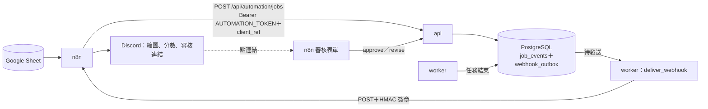

# Plan 9：n8n 自動化整合 設計規格

- 日期：2026-11-05
- 狀態：設計決定已由使用者確認（§3），文件待審閱
- 相關：
  - `2026-10-07-phase2-backend-design.md`（事件溯源、`EventStore.append`、SAQ 佇列）
  - `2026-10-23-plan6b-gemini-vlm-design.md`（需求拆解、費用上限 `ledger.check`）
  - `2026-10-21-plan5-rag-design.md`（選圖後的歷史回寫）

## 1. 目標

目前所有任務都要在 Studio 手動建立、手動挑圖。本規格把系統接上 n8n，讓「進」與「出」都能自動化：

1. **試算表批次產圖**：Google Sheet 每一列是一個需求，n8n 逐列建立任務；任務結束後把階段、分數與連結回填到同一列。
2. **通知與人工審核**：任務結束（`done` 或 `needs_review`）時，Discord 收到縮圖、合規分數與審核連結；審核者在 n8n 表單上「核准」（選定候選圖）或「退回＋一句修改意見」（重新生成）。

後端要補上三樣東西：機器呼叫端的驗證、對外的 webhook（以 outbox 保證不漏送）、給 n8n 用的精簡自動化 API。

不在本規格內：自製 n8n 節點套件（列為之後的延伸，§11）、多個 webhook 訂閱的管理 API、任務中途進度的 webhook、對外公開（Cloudflare Tunnel）。

## 2. 現況

| 項目 | 現況 |
|---|---|
| 建任務 | `POST /api/jobs`，需要完整的 `JobInput`（含 `parsed_brief`，要先呼叫 `POST /api/briefs/parse`） |
| 選圖 | `POST /api/jobs/{id}/select`，需要 `render_id` 與完整的 `copy` |
| 任務結束 | `job.status` 事件，`stage` 屬於 `FINISHED_STAGES`（`done`、`needs_review`、`cancelled`、`failed`） |
| 事件寫入 | `EventStore.append`：鎖住 `JobRow`、遞增 `last_seq`、寫入 `job_events`、commit，之後才發布到 Redis |
| 驗證 | 沒有。只靠埠綁 127.0.0.1 與 `HostCheck`（`allowed_hosts` 預設 `127.0.0.1`、`localhost`） |
| 對外通知 | 沒有 |

## 3. 已確認的決定

| 項目 | 決定 |
|---|---|
| n8n 的角色 | 前後都接：觸發建任務，也接收結果做通知與審核。不取代內部 Agent 流程 |
| 部署 | 自架，加進 `docker-compose.yml`，放在 `automation` profile（預設不啟動） |
| 第一版工作流 | 試算表批次產圖、Discord 通知＋審核表單 |
| 審核深度 | 可直接核准或退回（附修改意見並重新生成） |
| 通知頻道 | Discord webhook；按鈕改為「連結 → n8n 表單」，不需要對外公開 |
| 得知任務完成 | 後端對外發 webhook（outbox＋HMAC 簽章＋重試），不讓 n8n 輪詢 |
| 訂閱數量 | v1 只有一個 webhook URL，由環境變數設定 |
| n8n 用的 API | 另開 `/api/automation/*`，內部重用既有邏輯 |
| 退回上限 | 一條退回鏈最多 3 次，超過回 409 |
| n8n 資料庫 | 既有 PostgreSQL 內另一個資料庫 `n8n` |

## 4. 架構



n8n 以 compose 內部網路直接呼叫 `http://api:8000`，不經過 nginx。瀏覽器經 nginx 的流量維持現狀（不需要 token）。

### 4.1 入站驗證

- 新設定 `AUTOMATION_TOKEN`（至少 32 字元；空字串代表停用自動化 API，`/api/automation/*` 一律回 404）。
- `/api/automation/*` 要求 `Authorization: Bearer <token>`，以 `hmac.compare_digest` 比對；缺少或錯誤回 401。日誌不印出 token。
- 其他既有端點不要求 token（行為不變）。
- `allowed_hosts` 的 compose 預設值加上 `api`，讓內部主機名通過 `HostCheck`。

### 4.2 `client_ref` 與退回欄位

`JobInput` 新增三個選填欄位（舊任務沒有這些欄位，預設 `None`）：

| 欄位 | 型別 | 用途 |
|---|---|---|
| `client_ref` | `str \| None`（≤ 200 字元） | 呼叫端的參照（例如 `sheet:<sheetId>:row:12`）。後端不解讀，原樣存起來、在 webhook 帶回 |
| `parent_job_id` | `str \| None` | 由 revise 建立時，指向被退回的任務 |
| `reviewer_feedback` | `str \| None`（≤ 500 字元） | 審核者的修改意見 |

`reviewer_feedback` 怎麼生效：
- Prompt 構建時放在獨立的段落「審核者的修改意見（優先遵守，但不得違反品牌規範與護欄）」，不併進 `brief`。
- RAG 檢索的查詢文字加上 feedback，讓相關規範也一起被召回。
- Agent 透視頁另外顯示這段意見與上一個任務的連結。
- 前端與合約測資（`contracts/fixtures/`）同步加上三個欄位。

### 4.3 Outbox（交易內寫入）

新資料表 `webhook_outbox`（alembic migration）：

| 欄位 | 說明 |
|---|---|
| `id` | `wh_<12 位 hex>`，也是 `X-Webhook-Id`，重送時不變 |
| `job_id` | 外鍵 |
| `event` | v1 只有 `job.finished` |
| `payload` | JSONB，建立時就固定（§4.5） |
| `status` | `pending`、`delivered`、`dead` |
| `attempts` | 已嘗試次數 |
| `next_attempt_at` | 下一次可發送的時間 |
| `last_error` | 最後一次失敗的說明（HTTP 狀態與回應前 500 字元，或連線錯誤） |
| `created_at`、`delivered_at` | 時間 |

唯一索引 `(job_id, event)`：同一個任務只會有一筆結束通知。

寫入時機：`EventStore.append` 在**同一個交易**內，當事件是 `job.status` 且 `stage ∈ FINISHED_STAGES`、且 `WEBHOOK_URL` 有設定時，插入一筆 outbox。payload 需要的候選圖與分數在同一個 session 內讀取。交易回滾時 outbox 也不會留下；任務事件與「待通知」一定一起成立。

`WEBHOOK_URL` 沒有設定時不寫 outbox（不累積永遠不會送的資料）。

### 4.4 發送（`deliver_webhook`）

- 交易 commit 之後立即排一個 SAQ 任務 `deliver_webhook(outbox_id)`；排入失敗只記 warning（由 cron 補送）。
- worker 每 30 秒執行一次 cron，挑出 `status = 'pending' AND next_attempt_at <= now()` 的筆數排入。以 `SELECT … FOR UPDATE SKIP LOCKED` 取得，不重複發送；SAQ 以 outbox id 作為 key 去重。
- 發送：`httpx` POST，連線與讀取逾時各 10 秒，不跟隨轉址。
- 結果：
  - 2xx → `delivered`。
  - 4xx（408、429 除外）→ 直接 `dead`，因為重送也不會成功（例如驗簽失敗）。
  - 5xx、408、429、逾時、連線錯誤 → `attempts + 1`，依退避表設定 `next_attempt_at`：10 秒、1 分、5 分、15 分、30 分、1 小時、2 小時；第 8 次仍失敗 → `dead`。
- `WEBHOOK_URL` 只接受 `http`／`https`。內部網路的主機（`n8n`）是預期用法，不做私有網段限制；因為 URL 只能由部署者以環境變數設定，不會有 SSRF 的問題。

### 4.5 簽章與 payload

標頭：

| 標頭 | 內容 |
|---|---|
| `X-Webhook-Id` | outbox id |
| `X-Webhook-Event` | `job.finished` |
| `X-Webhook-Timestamp` | 本次發送的 Unix 秒數 |
| `X-Webhook-Signature` | `v1=` ＋ hex(HMAC-SHA256(`WEBHOOK_SECRET`, `"{timestamp}.{body}"`)) |

接收端（n8n Code 節點）重算簽章並以常數時間比對，拒絕時間差超過 300 秒的請求，並依 `X-Webhook-Id` 去重。

`job.finished` payload（camelCase，與既有 API 一致）：

```json
{
  "event": "job.finished",
  "webhookId": "wh_…",
  "jobId": "…",
  "clientRef": "sheet:…:row:12",
  "parentJobId": null,
  "stage": "done",
  "round": 1,
  "brandId": "…",
  "productId": "…",
  "brief": "…",
  "best": { "renderId": "…", "templateId": "ig-post", "score": 96, "passed": true, "imageUrl": "/files/…" },
  "renders": [ { "renderId": "…", "templateId": "…", "variant": 0, "score": 96, "passed": true, "imageUrl": "/files/…" } ],
  "failedChecks": [ { "id": "…", "label": "…", "detail": "…" } ],
  "reason": null,
  "studioUrl": "http://127.0.0.1:3000/…",
  "finishedAt": "2026-11-05T10:00:00+08:00"
}
```

- `imageUrl` 是相對路徑，n8n 以 `http://api:8000` 為前綴下載。
- `best` 為最後一輪分數最高的候選圖；`failed`、`cancelled` 時為 `null`，`reason` 帶失敗原因。
- `studioUrl` 以新設定 `STUDIO_BASE_URL` 加上前端現有的任務頁路徑組成，指向該任務。
- 這份 payload 加進 `contracts/fixtures/`，由測試比對 schema。

### 4.6 自動化 API（`backend/app/api/automation.py`）

全部要求 §4.1 的 token。

**`POST /api/automation/jobs`** → 201 `{ jobId }`

輸入：`brandId`、`productId`、`brief`、`clientRef`；選填 `templateIds`、`variantsPerTemplate`、`visualStyleId`。

- 在伺服器端呼叫 `agent.parse_brief`（與 `/api/briefs/parse` 相同的逾時），再組出 `JobInput`。
- 沒有指定的欄位用設定的預設值：`AUTOMATION_TEMPLATES`（預設 `ig-post,story,ecom-main`）、`AUTOMATION_VARIANTS`（預設 2）、`max_retries` 與 Studio 預設相同；`llm`、`vlm`、`engine` 取 `api_options` 的第一個。
- 之後走既有的 `_validate` 與 `create_job`（同樣的費用上限檢查：429 與 503 照原樣回傳中文說明）。

**`POST /api/automation/jobs/{id}/approve`** → 201 `HistoryEntry`

輸入：選填 `renderId`（不填就用 `best`）。

- 任務必須是 `done` 或 `needs_review`，否則 409。
- 文案取該候選圖本身的 `spec.copy`，呼叫與 `select_render` 相同的內部函式（抽出共用，不複製）。

**`POST /api/automation/jobs/{id}/revise`** → 201 `{ jobId }`

輸入：`feedback`（1–500 字元）。

- 任務必須已結束（`FINISHED_STAGES`），否則 409。
- 以原任務的 `input` 另開新任務：`parent_job_id` 設為原任務、`reviewer_feedback` 設為輸入、`client_ref` 沿用、`parsed_brief` 沿用不重拆。
- 沿著 `parent_job_id` 往上數，已經有 3 次退回時回 409「已退回 3 次，請到 Studio 手動處理」。

**冪等性**：approve 與 revise 接受 `Idempotency-Key` 標頭（≤ 100 字元）。新資料表 `automation_requests(key, action, job_id, response, created_at)`，以 `(key, action)` 為主鍵：同一個 key 再次呼叫時直接回傳第一次的回應，不重複執行。紀錄保留 7 天，由既有的定期清理一併刪除。

### 4.7 系統狀態

`/api/status` 新增一個元件「Webhook」：沒有設定時為 `off`；有 `dead` 時為 `error`，附上筆數與最後一次錯誤；`pending` 超過 10 筆時為 `warning`；其餘為 `ok`。Studio 儀表板沿用既有的狀態顯示，不另做頁面。

## 5. n8n 工作流

檔案放在 `n8n/workflows/`，容器啟動時以 `n8n import:workflow` 匯入。憑證（Google OAuth、Discord webhook URL）**不進 repo**，由使用者在 n8n 介面設定；`.env.example` 只列出變數名稱。

### 5.1 `poster-batch-submit`：試算表 → 建任務

Sheet 欄位：`brand`、`product`、`brief`、`status`、`jobId`、`score`、`posterUrl`、`message`。

1. Schedule（每 5 分鐘）或手動觸發。
2. Google Sheets：讀取 `status` 為空的列。
3. 逐列（Split In Batches，每批 1 筆）呼叫 `POST /api/automation/jobs`，`clientRef` 為 `sheet:<sheetId>:row:<rowNumber>`。
4. 成功：`status = queued`、寫入 `jobId`。失敗：`status = error`、`message` 寫入 API 回傳的說明，繼續下一列。

### 5.2 `poster-job-finished`：webhook → 回填＋通知

1. Webhook 觸發（`POST /webhook/poster-job-finished`）。
2. Code 節點：驗簽、檢查時間差、依 `webhookId` 去重（n8n 的 workflow static data，保留最近 1000 筆）。不通過回 401。
3. 立即回 200（後續節點非同步執行，避免後端逾時重送）。
4. `clientRef` 以 `sheet:` 開頭時：更新那一列的 `status`、`score`、`posterUrl`（`studioUrl`）、`message`（`reason` 或沒通過的檢查摘要）。
5. `stage` 為 `done` 或 `needs_review` 時：
   - 從 `http://api:8000{best.imageUrl}` 下載縮圖。
   - 以**附件**上傳到 Discord webhook（本機圖片網址是 127.0.0.1，Discord 抓不到，不能只放連結）。訊息內容：品牌、需求、分數、沒通過的檢查、Studio 連結、審核表單連結。
   - Wait 節點（等表單送出）：表單有候選圖下拉選單（預設 `best`）、「核准／退回」選項、修改意見欄位。
   - 核准 → `approve`；退回 → `revise`。`Idempotency-Key` 為 `webhookId` ＋ 動作名稱。
   - 結果回覆到 Discord（核准：已選定；退回：新任務 id）。revise 產生的新任務結束後，又會觸發這條工作流。

### 5.3 `poster-error`：錯誤工作流

設為上面兩條工作流的 Error Workflow：把工作流名稱、節點與錯誤訊息發到 Discord。

## 6. 錯誤處理

| 情況 | 處理方式 |
|---|---|
| n8n 停機或回 5xx | outbox 依退避表重試 8 次，之後 `dead`；`/api/status` 顯示 |
| n8n 回 4xx（例如驗簽失敗） | 直接 `dead`，記錄回應內容 |
| Redis 停止，`deliver_webhook` 排不進去 | 只記 warning；Redis 恢復後由 cron 補送 |
| worker 在發送中被結束 | 該筆仍是 `pending`，cron 之後重送；接收端依 id 去重 |
| 建任務被拒（429、503、400） | n8n 把該列寫成 `error` 並附上說明，不中斷整批 |
| n8n 工作流出錯 | `poster-error` 發到 Discord |
| 同一個表單送出兩次 | `Idempotency-Key` 回傳第一次的結果 |
| 退回超過 3 次 | 409，n8n 回覆到 Discord 請人到 Studio 處理 |
| token 錯誤或缺少 | 401 |

## 7. 設定

| 變數 | 預設 | 說明 |
|---|---|---|
| `AUTOMATION_TOKEN` | 空（停用） | n8n 呼叫自動化 API 用的 token |
| `WEBHOOK_URL` | 空（停用） | compose 內為 `http://n8n:5678/webhook/poster-job-finished` |
| `WEBHOOK_SECRET` | 空 | `WEBHOOK_URL` 有設定時必填（啟動時檢查，至少 32 字元） |
| `STUDIO_BASE_URL` | `http://127.0.0.1:3000` | 組 `studioUrl` |
| `AUTOMATION_TEMPLATES` | `ig-post,story,ecom-main` | 自動化建任務的預設模板 |
| `AUTOMATION_VARIANTS` | 2 | 每個模板的預設候選張數 |

n8n 容器另外使用 `N8N_ENCRYPTION_KEY`、`DB_POSTGRESDB_*`，以及把 `AUTOMATION_TOKEN`、`WEBHOOK_SECRET`、`DISCORD_WEBHOOK_URL`、`GOOGLE_SHEET_ID` 傳進工作流的環境變數。

## 8. Compose

- 新服務 `n8n`：官方映像並固定版本，`profiles: [automation]`，埠只綁 `127.0.0.1:5678`，以映像內建的 `node` 使用者執行（非 root），`restart: unless-stopped`。
- 資料庫：既有 postgres 內的資料庫 `n8n`，由 postgres 的初始化腳本建立；已經初始化過的 volume 由 n8n 的 entrypoint 檢查並建立。
- entrypoint：匯入 `n8n/workflows/*.json` 後啟動。
- 啟動指令：`docker compose --profile automation up -d`。
- 記憶體：n8n 閒置約 200–300 MB（實作時實測，結果記錄在本文件最後新增的「實驗結果」一節）；預設 profile 不啟動，不影響現有的 16 GB 配置。

## 9. 測試

**後端單元測試**（不需要 n8n）：
- Outbox：結束階段寫入一筆；非結束階段不寫；同一個任務只有一筆；交易回滾時沒有 outbox；`WEBHOOK_URL` 沒有設定時不寫。
- 簽章：固定 secret、timestamp 與 body，比對 golden 值。
- 發送：2xx → delivered；4xx → dead；5xx 與逾時依退避表；第 8 次 → dead；cron 只挑到期的 pending，並以 `SKIP LOCKED` 不重複取得（以 respx 模擬接收端）。
- 自動化 API：401（缺少、錯誤）；token 為空時 404；預設值補齊；approve 預設取 best、未結束回 409；revise 沿用欄位、第 4 次回 409；冪等鍵重放回傳同一個結果。
- `reviewer_feedback` 出現在 Prompt 構建的輸入與 RAG 查詢中（以錄下的 Gemini 回應重播）。

**契約測資**：`contracts/fixtures/webhook-job-finished.json`，後端產生的 payload 必須符合；`JobInput` 的三個新欄位同步到前端型別與 mock。

**live E2E**（標記 `live`，手動執行）：`docker-compose.e2e.yml` 加上 n8n 與一個本機的假接收端（代替 Google Sheets 與 Discord），以 `sim` 引擎跑完「建任務 → webhook → 驗簽 → 核准」與「退回 → 新任務 → webhook」。

## 10. 驗收

1. `docker compose --profile automation up -d` 後，n8n 自動匯入 3 條工作流。
2. Sheet 填入 3 列需求，5 分鐘內全部變成 `queued`，結束後回填分數與連結。
3. Discord 收到附縮圖的訊息；在表單核准後，Studio 的歷史紀錄出現該圖，且 `writtenToRag` 為 true。
4. 退回並附意見後產生新任務；Agent 透視頁顯示該意見與上一個任務的連結。
5. 停掉 n8n、完成一個任務、再啟動 n8n：通知在退避時間內補送，且只處理一次。
6. 竄改簽章的請求被 n8n 拒絕（401），後端該筆標記 `dead`。
7. 預設 profile（不含 `automation`）的行為與記憶體用量不變。

## 11. 之後的延伸（不在本規格內）

- 自製 n8n 節點套件（TypeScript）：「GenAI Poster」動作節點與觸發節點，取代 HTTP Request 與 Code 驗簽。
- 多個 webhook 訂閱：資料表＋管理 API，每個訂閱各自的 secret 與事件篩選。
- 挑圖後存檔與發布：5 種通路尺寸上傳到 Google Drive 或社群草稿。
- Cloudflare Tunnel：讓 Telegram、Slack 的訊息內按鈕可以直接回呼。

## 12. 已知限制

- 審核表單是 `localhost:5678`，只有本機或同一個區網的人點得開（不開 Tunnel 的取捨）。
- v1 只有一個 webhook URL；換 URL 時，已經 `dead` 的通知不會自動改送新的 URL。
- 退回沿用原任務的 `parsed_brief`；若修改意見與原需求衝突（例如改價格），以修改意見為準。護欄「需求沒提到的價格不得出現」把 `reviewer_feedback` 視為需求的一部分，所以意見裡寫的價格可以出現。
