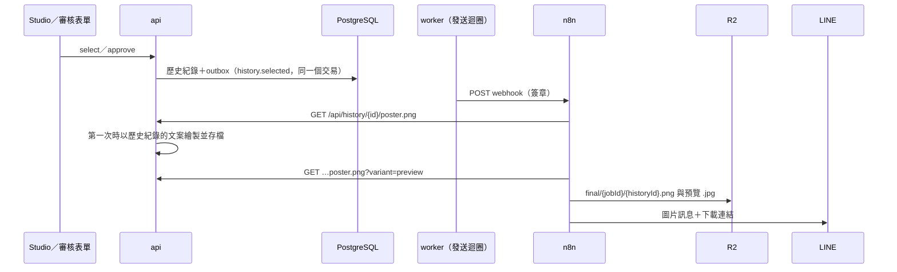

# 選圖後發布：定稿海報送到 R2 與 LINE 設計規格

> 2026-11-07。延續 Plan 9（n8n 自動化）§11「挑圖後存檔與發布」。範圍依使用者的決定縮小：發布到 Cloudflare R2＋LINE（不做 Google Drive 與社群草稿）、只發布選定的那一張、Studio 選定與審核表單核准都觸發。

## 1. 目標

審核者選定海報（Studio 的「選定」或 LINE 審核表單的「核准」）後，幾秒內在 LINE 收到**定稿**：原尺寸 PNG（含選定時的文案）與下載連結，檔案放在 R2，可以直接轉傳或下載使用。

不在範圍內：Google Drive、社群貼文草稿、一次輸出多個通路尺寸（每個通路模板各自生成自己的候選圖，同一張設計無法換成別的比例）、回填試算表的定稿網址。

## 2. 現況

- `record_selection`（`backend/app/api/jobs.py`）寫入歷史紀錄後排 `write_back`（回寫 RAG）。Studio 的 `POST /api/jobs/{id}/select` 與自動化 API 的 `approve` 都呼叫它。
- 審查用海報 `data/jobs/{jobId}/{renderId}.png` 是候選圖本身的文案；Studio 選定時可以改文案，歷史紀錄存的是改過的 `copy`。所以定稿要用歷史紀錄的文案重新繪製。
- composer 的 `/render` 依 `render.spec.copy` 繪製模板原尺寸的 PNG（與瀏覽器匯出共用 `paint.ts`）。
- webhook outbox 的唯一限制是 `(job_id, event)`：一個任務只會有一則 `job.finished`。同一個任務可以選定多次，所以新事件不能沿用這個限制。
- `JOB_WEBHOOK_URL` 只有一個，`poster-job-finished` 工作流接收全部事件。

## 3. 設計

### 3.1 事件 `history.selected`

- `record_selection` 在**寫入歷史紀錄的同一個交易**插入 outbox（`JOB_WEBHOOK_URL` 有設定時），不會有「選定了卻沒通知」或反過來。
- payload：

| 欄位 | 內容 |
|---|---|
| `event` | `history.selected` |
| `webhookId` | outbox id |
| `historyId`、`jobId`、`renderId`、`templateId` | 識別 |
| `brandId`、`productId`、`brief` | 任務輸入 |
| `score` | 候選圖分數 |
| `source` | `studio` 或 `automation` |
| `clientRef` | 任務的 clientRef（來自試算表時） |
| `posterUrl` | `/api/history/{historyId}/poster.png`（api 的路徑，n8n 加上 `AUTOMATION_API_URL`） |
| `studioUrl` | 該任務的 Studio 連結 |
| `selectedAt` | 選定時間 |

- 唯一限制改為「`job.finished` 每個任務一則」：migration 0006 移除 `uq_webhook_outbox_job_event`，改成部分唯一索引 `(job_id) WHERE event = 'job.finished'`。

### 3.2 定稿檔案 `GET /api/history/{id}/poster.png`

- 第一次請求時：讀歷史紀錄，把 `render.spec.copy` 換成歷史紀錄的 `copy`，以和審查用海報相同的方式（商品圖、Logo、背景圖）呼叫 composer `/render`，存到 `data/history/{historyId}.png`；之後直接讀檔。
- `?variant=preview`：與 `/files/...?variant=preview` 相同的 JPEG（長邊 1600 px、1 MB 以內）。
- 找不到歷史紀錄 404；繪製失敗 502，說明原因（n8n 走錯誤輸出，改送純文字）。
- 同時兩個請求時可能各畫一次，寫檔以「先寫暫存檔再改名」避免讀到一半的檔案。

### 3.3 n8n（`poster-job-finished`）

- 驗簽、去重之後加一個「事件？」分流：`job.finished` 走原本的流程；`history.selected` 走定稿分支。
- 定稿分支：組出訊息（物件名稱 `final/{jobId}/{historyId}.png`、預覽 `final/{jobId}/{historyId}-preview.jpg`）→ 有設定 R2 時：下載定稿 → 上傳 → 下載預覽 → 上傳 → LINE 圖片訊息（原圖 PNG、預覽 JPEG）＋文字（品牌、商品、通路、分數、下載連結、Studio 連結）。任何一步失敗或沒有設定 R2 → 只送文字（不含下載連結）。
- 審核表單核准成功後原本回覆「✅ 已選定」，改由定稿訊息取代；核准失敗與退回照舊回覆。

## 4. 錯誤處理

| 情況 | 結果 |
|---|---|
| 沒有設定 `JOB_WEBHOOK_URL` | 不寫 outbox，選定照常 |
| composer 繪製失敗 | api 回 502；n8n 只送文字；可以在 Studio 的歷史紀錄重新下載 |
| R2 上傳失敗 | 只送文字 |
| n8n 停機 | outbox 依退避表重送（與 `job.finished` 相同） |
| 同一個任務選定兩次 | 兩則 `history.selected`、兩份定稿（歷史紀錄本來就是兩筆） |

## 5. 測試

- payload：欄位、`source`、`posterUrl`。
- outbox：Studio 選定與自動化核准都寫入；同一個任務兩次選定有兩則；`job.finished` 仍然只有一則；沒有設定 webhook 時不寫。
- 定稿端點：回傳模板原尺寸 PNG 並存檔、第二次讀檔、文案用歷史紀錄的、`variant=preview`、404。
- migration 0006 升級與降級。
- 工作流結構：事件分流、定稿分支的節點與錯誤輸出、核准成功不再回覆。
- 實測：Studio 選定一張 → LINE 收到定稿圖片與下載連結。
