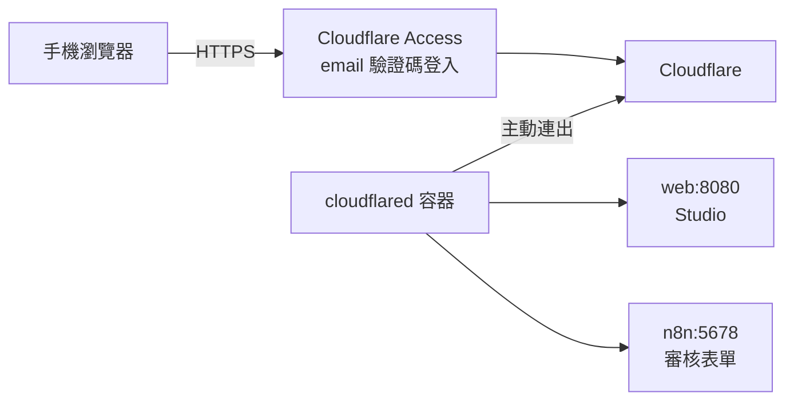

# 從手機開啟 Studio 與審核表單：Cloudflare Tunnel

LINE 訊息裡的 Studio 連結與 n8n 審核表單預設是 `http://127.0.0.1:…`，只有這台電腦打得開。
用 Cloudflare Tunnel 把兩者放到你自己的網域（例如 `studio.example.com`、`review.example.com`），手機用 4G 也打得開：



- 電腦不開任何對外的埠：`cloudflared` 從裡面主動連到 Cloudflare。
- **一定要設定 Cloudflare Access**：Studio 沒有登入功能，拿到網址的人都能建任務、花 Gemini 額度。Access 讓只有你的 email 能進來。

以下操作都在你自己的 Cloudflare 帳號進行；repo 不放任何 token。Cloudflare 的介面名稱偶爾會調整，找不到選項時以頁面上的搜尋或同名的設定為準。

## 0. 需要一個網域

Tunnel 的公開網址要用加到 Cloudflare 的網域（`workers.dev` 不行）。沒有的話在 Cloudflare 儀表板 → **Domain Registration** 購買，或把既有網域加到 Cloudflare（**Add a domain**，照指示更改名稱伺服器）。

## 1. 先設定 Cloudflare Access（在開啟 Tunnel 之前）

Zero Trust 儀表板（<https://one.dash.cloudflare.com/>）→ **Access** → **Applications** → **Add an application** → **Self-hosted**：

| 欄位 | 值 |
|---|---|
| Application name | `genai-agent-studio` |
| Public hostname | `studio.example.com` 與 `review.example.com`（按 **Add public hostname** 加第二個） |
| Policy | Action 選 **Allow**；Include 選 **Emails**，填你的 email |
| Login methods | **One-time PIN**（寄驗證碼到 email，不需要其他帳號） |

第一次使用 Zero Trust 時會要求選方案：選 **Free**（50 人以內免費）。

## 2. 建立 Tunnel

Zero Trust 儀表板 → **Networks** → **Tunnels** → **Create a tunnel** → **Cloudflared**，名稱例如 `genai-agent-studio`。

1. 安裝說明頁的指令裡有一段 `--token` 後面的長字串：只複製這段 token，填入 `.env` 的 `TUNNEL_TOKEN`（不用照頁面安裝 cloudflared，compose 會執行它）。
2. 下一步 **Public hostnames**（或 **Published application routes**）加兩筆：

| Subdomain | Domain | Service |
|---|---|---|
| `studio` | `example.com` | **HTTP** `web:8080` |
| `review` | `example.com` | **HTTP** `n8n:5678` |

`web`、`n8n` 是 compose 內部網路的名稱，`cloudflared` 容器直接連得到，與你本機用哪個埠（例如 3080）無關。

## 3. `.env`

```
TUNNEL_TOKEN=<上一步的 token>
PUBLIC_HOST=studio.example.com
STUDIO_BASE_URL=https://studio.example.com
N8N_PUBLIC_URL=https://review.example.com/
```

- `PUBLIC_HOST`：nginx 與 api 多接受這個主機名稱（防止 DNS rebinding 的檢查；其他名稱照樣拒絕）。`.env` 自訂了 `ALLOWED_HOSTS` 時，要自己把這個網域加進去。
- `STUDIO_BASE_URL`：LINE 訊息裡 Studio 連結的前綴。
- `N8N_PUBLIC_URL`：審核表單連結的前綴（結尾要有 `/`）。

## 4. 啟動

```bash
docker compose --profile automation --profile tunnel up -d --build
```

`--build` 重新建置 web（nginx 的設定在啟動時代入 `PUBLIC_HOST`）；改了 `.env` 的容器（api、worker、n8n）會重新建立。

確認 Tunnel 已連線：Zero Trust 儀表板的 Tunnel 狀態為 **Healthy**，或

```bash
docker compose logs cloudflared --tail 20
```

看到 `Registered tunnel connection` 即可。

## 5. 測試

1. 手機關掉 Wi-Fi（用 4G），開啟 `https://studio.example.com`：先出現 Cloudflare Access 的登入頁，輸入 email、收驗證碼後進入 Studio。
2. 建一個新任務，任務結束後 LINE 訊息的 Studio 與審核表單連結都是 `https://…` 的網址，手機點得開。

LINE 內建的瀏覽器有時不保留 Access 的登入狀態：每次都要求登入時，在訊息連結上長按、選擇用外部瀏覽器開啟。

## 注意事項

- 在設定 Tunnel 之前就送出的 LINE 訊息，連結還是 `127.0.0.1`。
- `review.example.com` 也開得到 n8n 的編輯介面（同樣在 Access 後面，還要 n8n 自己的帳號密碼）。
- 後端呼叫 n8n webhook 走 compose 內部網路（`http://n8n:5678`），不經過 Tunnel 與 Access。
- 不用時停止：`docker compose stop cloudflared`。
