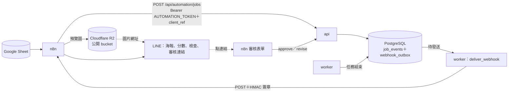

# n8n 自動化

以 n8n 串起「試算表批次產圖」與「LINE 通知＋人工審核」。工作流放在 `n8n/workflows/`，n8n 第一次啟動時自動匯入；
後端的自動化 API 與 webhook 見 `docs/superpowers/specs/2026-11-05-plan9-n8n-automation-design.md`。

## 1. 用途

| 工作流 | 做什麼 |
|---|---|
| `poster-batch-submit` | 每 5 分鐘（或在介面按 Execute workflow 手動執行）讀取 Google Sheet 中 `status` 為空的列，逐列呼叫 `POST /api/automation/jobs`（`clientRef` 為 `sheet:<sheetId>:row:<列號>`）。成功時該列寫入 `status=queued` 與 `jobId`；失敗時寫入 `status=error` 與 API 回傳的說明，繼續處理下一列 |
| `poster-job-finished` | 接收後端的 `job.finished` 與 `history.selected` webhook（`POST /webhook/poster-job-finished`）：驗證簽章、拒絕時間差超過 300 秒的請求、依 `X-Webhook-Id` 去重（保留最近 1000 筆），不通過回 401，通過立即回 200。來自試算表的任務以 `jobId` 找到那一列（退回產生的任務找上一個任務的 `jobId`，並把 `jobId` 換成新任務），回填 `status`、`score`、`posterUrl`、`message`；`done` 或 `needs_review` 時把最高分的審查用海報縮成 JPEG 預覽圖上傳到 Cloudflare R2，以 LINE 圖片訊息加上文字（分數、未通過的檢查、候選圖與審核表單連結）推播；沒有設定 R2、沒有海報或上傳失敗時只送文字，表單送出後呼叫 `approve`（核准）或 `revise`（退回並附修改意見）；退回與核准失敗時推播結果。<br>**選圖後發布**：Studio 選定或表單核准後收到 `history.selected`，下載定稿（選定時的文案、模板原尺寸 PNG）與預覽，上傳到 R2 的 `final/{jobId}/{historyId}.png`，以 LINE 圖片訊息加上下載原圖的連結推播；沒有設定 R2 或任何一步失敗時只送文字 |
| `poster-error` | 上面兩條的錯誤工作流（Settings → Error workflow）：把工作流名稱、出錯的節點與錯誤訊息推播到 LINE |



n8n 在 compose 內部網路直接呼叫 `http://api:8000`，不經過 nginx。

## 2. 啟動

1. 在 repo 根目錄的 `.env` 設定下面四個變數（`.env.example` 的「自動化」一節有說明）。三個金鑰各自產生一次：

   ```bash
   python -c "import secrets; print(secrets.token_urlsafe(32))"
   ```

   | 變數 | 內容 |
   |---|---|
   | `AUTOMATION_TOKEN` | n8n 呼叫 `/api/automation/*` 的 token（至少 32 字元） |
   | `JOB_WEBHOOK_URL` | `http://n8n:5678/webhook/poster-job-finished` |
   | `JOB_WEBHOOK_SECRET` | webhook 的簽章金鑰（至少 32 字元），後端簽章、n8n 驗證用同一個值 |
   | `N8N_ENCRYPTION_KEY` | n8n 加密已儲存憑證的金鑰；設定後不要更改，否則 n8n 讀不到已儲存的憑證 |

   另外視需要設定 `LINE_CHANNEL_ACCESS_TOKEN`、`LINE_TO`、`R2_BUCKET`、`R2_PUBLIC_BASE_URL`（§3）與 `GOOGLE_SHEET_ID`（Sheet 網址 `/d/` 與 `/edit` 之間的那一段）。
   `AUTOMATION_TOKEN`、`JOB_WEBHOOK_SECRET`、`N8N_ENCRYPTION_KEY` 任一個沒有設定時，n8n 容器會印出說明並結束。

2. 啟動（含原本的整套服務）：

   ```bash
   docker compose --profile automation up -d --build
   ```

   沒有加 `--profile automation` 時不會啟動 n8n。若 `.env` 設了 `JOB_WEBHOOK_URL` 卻沒有執行 n8n，通知會依退避表重試、最後變成 `dead`；不使用 n8n 時請把 `JOB_WEBHOOK_URL` 留空。`n8n-db` 會在既有的 PostgreSQL 內建立資料庫 `n8n`（已經存在就略過）。

3. 第一次開啟 <http://127.0.0.1:5678> 時建立擁有者帳號（帳號只存在本機的 n8n 資料庫）。

## 3. 憑證

憑證不進 repo；匯入的工作流裡只有憑證名稱，要在介面重新選擇。

- **Google Sheets**：在 Google Cloud Console 建立「OAuth 用戶端 ID」（類型：網頁應用程式），授權的重新導向 URI 填
  `http://127.0.0.1:5678/rest/oauth2-credential/callback`，並啟用 Google Sheets API。
  在 n8n 新增「Google Sheets OAuth2 API」憑證，填入用戶端 ID 與密鑰後按 Sign in with Google。
  接著在四個 Google Sheets 節點選擇這個憑證：`poster-batch-submit` 的「讀取待處理的列」、「標記排隊中」、「標記錯誤」，
  以及 `poster-job-finished` 的「回填試算表」。
  也可以先建立憑證並命名為 `Google Sheets account`（工作流裡的憑證名稱），再依 §6 重新匯入：匯入時 n8n 依名稱與類型自動選上同名的憑證。
- **LINE**：不需要在 n8n 建立憑證，只要 `.env` 的 `LINE_CHANNEL_ACCESS_TOKEN` 與 `LINE_TO`。通知用 LINE Messaging API 的推播（LINE Notify 已停止服務）：
  1. 在 [LINE Developers](https://developers.line.biz/console/) 建立 Provider 與 **Messaging API** channel（會同時建立一個 LINE 官方帳號）。
  2. channel 的 **Messaging API** 分頁最下方發行 **Channel access token (long-lived)**，填入 `LINE_CHANNEL_ACCESS_TOKEN`。
  3. 推播給自己：**Basic settings** 分頁的 **Your user ID**（U 開頭）填入 `LINE_TO`，並用手機掃 Messaging API 分頁的 QR code 加官方帳號為好友（沒有加好友收不到）。
     推播到群組：把官方帳號邀進群組（官方帳號管理頁要允許加入群組），群組 id（C 開頭）要從 LINE 送到 channel webhook 的 `join` 事件取得。
  4. 免費方案每月的推播則數有上限（每個結束的任務一則，加上審核結果與錯誤各一則），超過時推播回 429，n8n 的錯誤工作流也推不出去；用量見 LINE Official Account Manager。
- **Cloudflare R2**（LINE 訊息附海報；不設定時只送文字）：LINE 的圖片訊息只接受公開的 HTTPS 網址，所以 n8n 從 api 下載預覽圖（`/files/jobs/…png?variant=preview`：長邊最多 1600 px、1 MB 以內的 JPEG）後上傳到 R2，物件名稱為 `review/{jobId}/{renderId}-{webhookId}.jpg`。
  1. Cloudflare 控制台 → **R2** → **Create bucket**（例如 `posters`），填入 `.env` 的 `R2_BUCKET`。
  2. bucket 的 **Settings** → **Public access** 開啟 **R2.dev subdomain**（或連接自己的網域），把網址（`https://pub-….r2.dev`，結尾不要 `/`）填入 `R2_PUBLIC_BASE_URL`。
  3. 建議在 bucket 的 **Settings** → **Object lifecycle rules** 設定 `review/` 前綴（審查用海報）的物件 30 天後刪除；`final/` 是定稿，依需要保留。
  4. **R2** → **Manage API tokens** → **Create API token**：權限選 **Object Read & Write**、只限這個 bucket，記下 Access Key ID、Secret Access Key 與 S3 endpoint（`https://<帳戶 id>.r2.cloudflarestorage.com`）。
  5. n8n 新增 **S3** 憑證，命名為 `Cloudflare R2`：S3 Endpoint 填上面的 endpoint、Region 填 `auto`、填入兩個 key，勾選 **Force Path Style**。在 `poster-job-finished` 的「上傳 R2」、「上傳定稿」、「上傳定稿預覽」三個節點選擇這個憑證（或先建立憑證再依 §6 重新匯入：依名稱自動選上）。
  6. 修改 `.env` 後執行 `docker compose --profile automation up -d n8n`。
  注意：bucket 公開後，知道網址的人都看得到海報（網址含任務與通知 id，不容易猜到）。未發表的商品不想放到公開網址時，不要設定 R2，只送文字。
  修改 `.env` 後執行 `docker compose --profile automation up -d n8n` 讓 n8n 讀到新的值。

`poster-job-finished` 的節點還沒選好憑證時，n8n 會以 400 拒絕 webhook，後端會把這筆通知標記為發送失敗（`/api/status` 的 Webhook 顯示錯誤）。
不使用試算表時，可以在介面把「回填試算表」節點停用（Deactivate）。

## 4. 試算表格式

工作表名稱為 `需求`，第一列是欄位名稱：

| brand | product | brief | status | jobId | score | posterUrl | message |
|---|---|---|---|---|---|---|---|
| 品牌 id | 商品 id | 需求（一句話） | 留白 | 留白 | 留白 | 留白 | 留白 |

- 只處理 `status` 為空的列；處理後依序變成 `queued` → 任務結束的階段（`done`、`needs_review`、`failed`、`cancelled`）或 `error`。
- `score` 為最高分候選圖的分數，`posterUrl` 為 Studio 的任務頁，`message` 為失敗原因或沒通過的檢查。
- 想重新產生某一列時，清空它的 `status`（保留 `jobId`）。
- 任務結束時以 `jobId` 欄找到要回填的列，所以任務進行中插入、刪除或排序列都沒關係；不要修改 `jobId` 欄。
- 「建立任務」送出 `Idempotency-Key`：列號加上品牌、商品、需求與上一個 `jobId` 的 SHA-256。排程重疊或回寫試算表失敗後重跑時，
  內容沒變的列回傳同一個任務，不會重複花錢；改了內容或清空 `status` 重新產生時是新的鍵。

## 5. 啟用

在介面開啟三條工作流，各按一次右上角的 **Publish**（n8n 2 以發布取代舊版的 Active 開關）。
`poster-error` 也要發布：n8n 2.46.6 不會執行沒有發布的錯誤工作流（log 顯示 `Workflow "poster-error" is not active and cannot be executed`）。

審核流程：LINE 訊息附上最高分的審查用海報（有設定 R2 時）與「審核表單」連結。表單的「決定」選核准或退回；「候選圖」填訊息裡列出的 `renderId`
（空白為最高分）；「修改意見」在退回時使用（空白為「請重新生成」）。同一張表單送出兩次時，後端以 `Idempotency-Key` 回傳第一次的結果。
表單 7 天內沒有送出就結束等待，不核准也不退回。

核准成功後不另外回覆「已選定」，改由定稿訊息通知（見下一段）。

選圖後發布：在 Studio 按「選定」或在表單核准，幾秒內 LINE 收到「🎉 定稿」訊息：定稿圖片（選定時的文案）、品牌、商品、通路、分數，以及 R2 上原尺寸 PNG 的下載連結。定稿第一次被下載時由 api 繪製並存到 `data/history/{historyId}.png`（`GET /api/history/{historyId}/poster.png`）。同一個任務選定兩次會收到兩則定稿。

## 6. 更新工作流

n8n 只在 volume 第一次啟動時匯入 `n8n/workflows/`（標記檔 `/home/node/.n8n/.imported`），之後不會覆蓋介面上的修改。
repo 的 JSON 改了之後執行：

```bash
docker compose exec n8n n8n import:workflow --separate --input=/workflows
docker compose restart n8n
```

匯入會覆蓋同 id 的工作流（含憑證的選擇），之後在介面重新選擇憑證並重新 Publish。

把介面上的修改存回 repo：

```bash
docker compose exec n8n n8n export:workflow --all --separate --output=/tmp/wf
docker compose cp n8n:/tmp/wf/. n8n/workflows/
```

匯出後檢查：檔名與 JSON 的 `id` 是固定的 `poster-batch-submit`、`poster-job-finished`、`poster-error`；
每個節點 `credentials` 裡的 `id` 改成空字串（保留 `name`）；兩條主要工作流的 `settings.errorWorkflow` 為 `poster-error`。
`backend/tests/test_n8n_workflows.py` 會檢查這幾點，以及檔案裡沒有 LINE 的 token。

## 7. 重新發送失敗的通知

通知放棄發送（`dead`）後不會自動重試。24 小時內的 `dead` 會讓系統狀態的 Webhook 顯示 error，更早的只在說明文字提到筆數。問題排除後（例如 n8n 已啟動、工作流已發布、憑證已選好），把它們重新排入發送：

```bash
docker compose exec postgres psql -U genai -d genai -c "UPDATE webhook_outbox SET status='pending', attempts=0, next_attempt_at=now(), last_error=NULL WHERE status='dead';"
```

在 `poster-job-finished` 發布、憑證選好之前送出的通知，n8n 會回 404 或 400，後端視為永久失敗，立刻變成 `dead`；請在完成設定後執行上面的指令補送。

## 8. 注意事項

- 不使用 R2 時，「上傳 R2」節點沒有選憑證會讓 n8n 拒絕 webhook（§3）：在介面把它停用（Deactivate），或照樣建立一個 `Cloudflare R2` 憑證。
- Studio 建立的任務結束時也會發 LINE 審核訊息；在 Studio 選定海報後又在審核表單核准，歷史紀錄會多一筆。
- `N8N_BLOCK_ENV_ACCESS_IN_NODE=false` 讓能編輯工作流的人讀到容器的環境變數（本機單人使用可以接受）。
- n8n 與應用程式共用資料庫帳號 `genai`。

## 9. 已知限制

- 審核表單的網址預設是 `http://127.0.0.1:5678/...`，只有本機打得開；要從手機開啟見 [docs/tunnel.md](../docs/tunnel.md)（Cloudflare Tunnel＋Access）。
- LINE 訊息只在設定 R2 時附圖；`REVIEW_MODE=sim` 時沒有審查用海報，只送文字。訊息裡的 Studio 與審核表單連結預設是 `127.0.0.1`，在手機上點開不了；設定 Cloudflare Tunnel（[docs/tunnel.md](../docs/tunnel.md)）後改為你的網域。
- v1 只有一個 webhook 網址；換網址時，已經發送失敗的通知不會改送新的網址。
